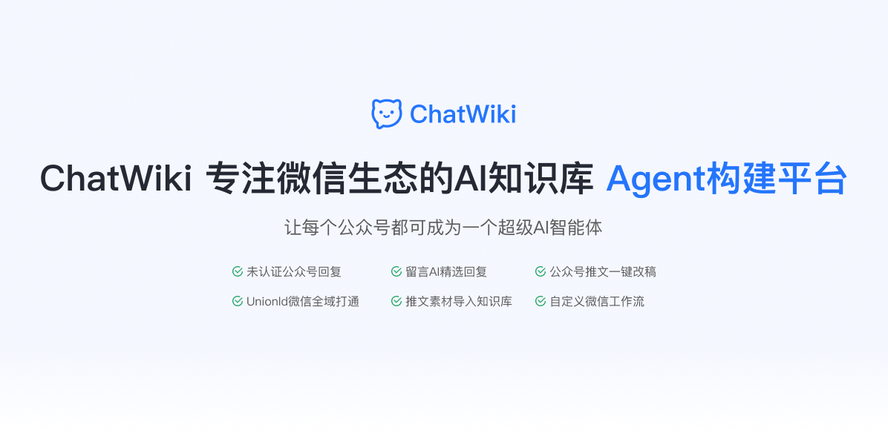
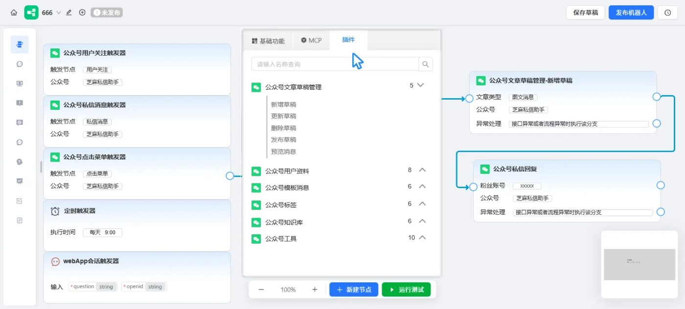
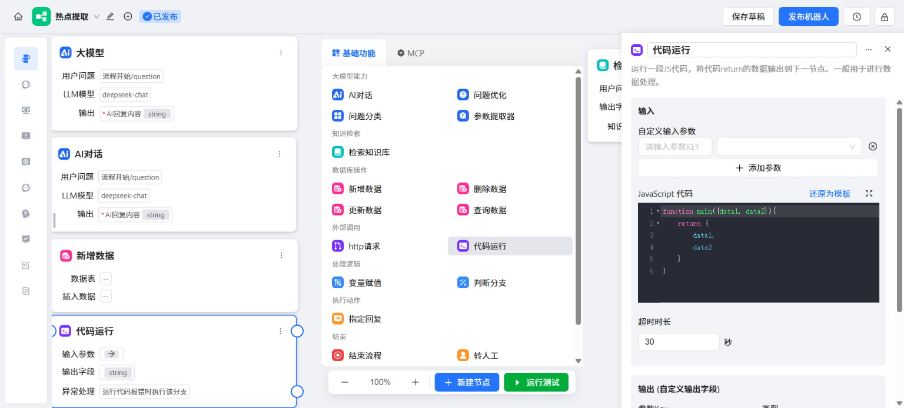
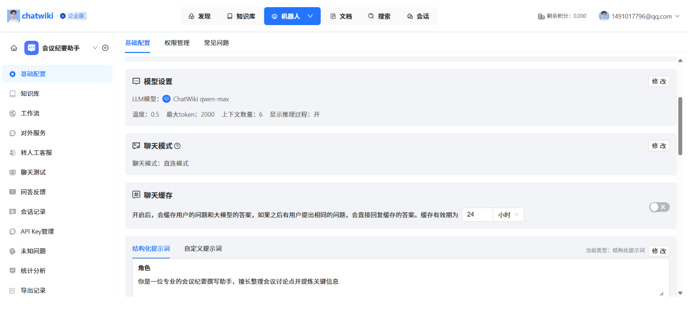
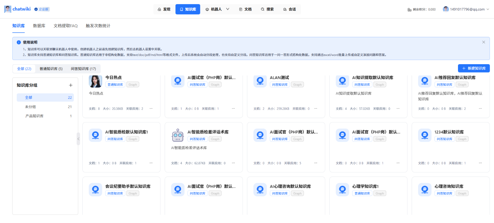
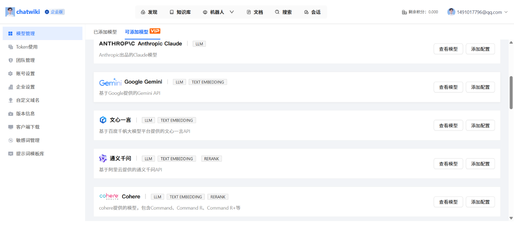
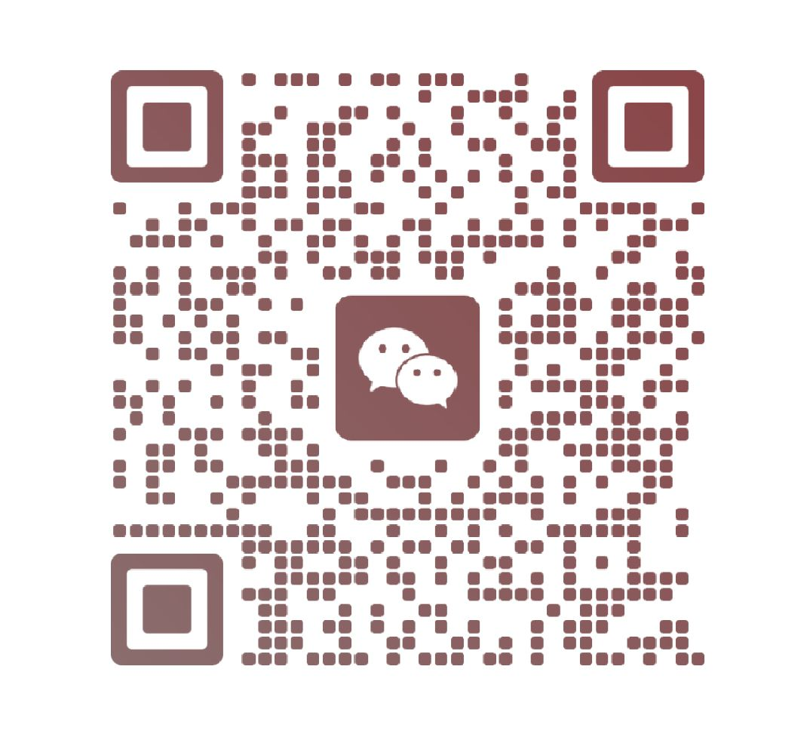

<p align="center"><a href="https://Chatwiki.com/"></a></p>

<p align="center">
  <a href="./README.md">English</a> |
  <a href="./README_zh.md">简体中文</a> |
  <a href="./UpdateLog.md">UpdateLog</a> |
  <a href="https://www.yuque.com/zhimaxiaoshiwangluo/pggco1/ykeoauc4g9k2dwv1">Help Docs</a>
</p>

## 🎯 Product Positioning

ChatWiki is a workflow automation platform focused on the WeChat ecosystem, dedicated to making every official account a
super AI agent. It fully integrates the open capabilities of the official account platform, allowing you to build WeChat
ecosystem applications through drag-and-drop, enabling features like one-click rewriting of official account articles
and AI-curated comment replies.



## ✨ Core Features

### 💬 Deep Integration with WeChat Ecosystem

- **Industry First**: Automatic reply to private messages for unverified official accounts, supporting text, voice,
  images, mini-program cards, video messages, etc.

- **WeChat Workflows**: Integrates trigger scenarios such as user private messages, comments, follows, unfollows, menu
  clicks, etc. Supports various processing steps like replying to private messages, tagging fans, generating draft
  articles, publishing articles, and more.

- **Knowledge Base Synchronization**: Supports scraping articles and materials from official accounts to build a
  knowledge base with one click.

### 🤖 Basic Capabilities

- **Workflow Orchestration**: Conversational workflows, plugin workflows, including basic workflow nodes, bidirectional
  MCP, Agent mode, and user interaction.

- **Document Knowledge Base**: Supports URL reading, batch document import, API integration, AI-based segmentation, QA
  segmentation, parent-child segmentation, and hybrid search.

- **QA Knowledge Base**: Automatically extracts QA knowledge from uploaded documents, supports automatic clustering of
  unknown questions, and summarizes common FAQs from human conversations.

- **Human Handoff**: Handles general user inquiries via bot, while also supporting human staff. Issues that the bot
  cannot resolve can be escalated to human客服, with multi-agent collaborative assignment.

- **Model Support**: Supports over 20 mainstream global models, including DeepSeek R1, doubao pro, qwen max, OpenAI,
  Claude, etc.

### 🌐 More Capabilities

- **Multiple Deployment Options**: Offers desktop client, supports publishing as a WebApp, and embedding into websites,
  official accounts/service accounts, wecome staff, WeChat store staff, etc.

- **MCP & API Integration**: Allows integration of external MCP services or publishing workflows as MCP services.
  Complete OpenAPI interface for easy integration with existing business systems.

- **Multi-account Permission Management**: Three-tier permission system (admin, editor, viewer) ensures data isolation.
  IP whitelist and permanent login logs.

## 🛸 UI

- 🌍 **Free Trial URL**: [chatwiki.com](https://chatwiki.com/)
- 🖼️ **Screenshots**:

<p align="center">       </p> 
<p align="center">       </p> 

## 🚀 One-Click Deployment

ChatWiki Community Edition is deployed using Docker and can be installed in just a few simple steps:

```
# Install Docker
sudo curl -sSL https://get.docker.com/ | CHANNEL=stable sh
# Clone the project
git clone https://github.com/zhimaAi/chatwiki.git
cd chatwiki/docker
# Start the service
docker compose up -d
# Start using it, access via IP:port (ensure the specified port ${CHAT_SERVICE_PORT}, default 18080, is open)
# Default username: admin
# Default password: chatwiki.com@123
```

For any issues or suggestions during installation and deployment,
please [contact us](https://github.com/zhimaAi/chatwiki?tab=readme-ov-file#contact-us) or refer to
the [help documentation](https://www.yuque.com/zhimaxiaoshiwangluo/pggco1?source=aHR0cHM6Ly9jaGF0d2lraS5jb20v) for
assistance. You can also check the guides below.

- [Installing ChatWiki via Installation Assistant](https://www.yuque.com/zhimaxiaoshiwangluo/pggco1/tvwn5npk63aqikq1)

- [One-Click Deploy ChatWiki Community Edition](https://www.yuque.com/zhimaxiaoshiwangluo/pggco1/wql8ekkylbwegbzo)

- [Docker Mirror Site Installation + Offline Installation](https://www.yuque.com/zhimaxiaoshiwangluo/pggco1/aa3htgexhdocyagr)

- [Deploy ChatWiki Without Docker](https://www.yuque.com/zhimaxiaoshiwangluo/pggco1/klriercbhpy97o0g)

- [Deploy ChatWiki Community Edition on Baota Linux Panel](https://www.yuque.com/zhimaxiaoshiwangluo/pggco1/gefgwdfnclua7d9y)

- [Deploy ChatWiki Community Edition with 1Panel](https://www.yuque.com/zhimaxiaoshiwangluo/pggco1/munvto5g1ctc1gcu)

- [How to Configure Model Providers and Supported Models](https://www.yuque.com/zhimaxiaoshiwangluo/pggco1/pn79lkvl53bo0xxm)

- [Local Model Deployment](https://www.yuque.com/zhimaxiaoshiwangluo/pggco1/evmy0rr9gr2gp2i0)

- [How to Configure External Services and Domain for Push Notifications](https://www.yuque.com/zhimaxiaoshiwangluo/pggco1/nfk4slc95s4i8u4v)

- [How to Obtain Large Model API Keys](https://www.yuque.com/zhimaxiaoshiwangluo/pggco1/lx3ho90skq95dpdq)

## 💻 Tech Stack

----

- Frontend: vue.js

- Backend: golang + python

- Database: PostgreSQL16 + pgvector + zhparser

<h2>🏡 Community & Contact Us <a name="contact-us"></a></h2>

----
Feel free to contact us for help or to provide suggestions to improve ChatWiki. You can reach us through:

- **Help:** Check
  the [help documentation](https://www.yuque.com/zhimaxiaoshiwangluo/pggco1?source=aHR0cHM6Ly9jaGF0d2lraS5jb20v)
- **Email:** Send an email to [jarvis@2bai.com.cn](mailto:jarvis@2bai.com.cn) to contact us.
- **WeChat:** Scan the QR code below to join the ChatWiki tech community group. Please add the note "chatwiki" when
  adding.

<p align="left"></p>

## 📖 **Changelog**

---
For the complete changelog, please click 👉️👉️[UpdateLog.md](./UpdateLog.md)

**2026/11/13**

1.[STD] Conversation history now labels replies sent from Xiaohongshu<br/>
2.Updated how Agent menus work in the new interface<br/>
3.[STD] Registration can now skip the invitation code by default when configured<br/>
4.Added an AI tool for optimizing prompts<br/>
5.Added knowledge base settings to the redesigned knowledge base page<br/>
6.[STD] Free version: Fixed issues and added guidance on the model management page<br/>
7.Fixed the public bot configuration API to fall back to the legacy welcome message when no localized version is
configured<br/>
8.Removed Neo4j and knowledge graph retrieval logic<br/>
9.You can now view the corresponding conversation history from Q&A feedback<br/>
10.Bot names in the new interface now use 13px text and span at most two lines<br/>
11.Date filters in Analytics now support ranges of up to 31 days<br/>
12.[STD] Updated AI suggested reply logic in Original Text and Traditional modes<br/>
13.Alibaba Cloud Model Studio: Replaced `reasoning_effort=none` with a thinking toggle<br/>

**2026/11/06**

1.[STD] H5 cloud customer service: Added like and dislike buttons to LLM bot replies<br/>
2.[STD] Fixed the credit prices shown for ChatWiki's own models in the model selector<br/>
3.Added adjustable reasoning effort for LLMs in Deep Thinking mode<br/>
4.Permissions can now be set separately for each Agent bot<br/>
5.[STD] Fixed human handoff detection for repeated questions in multimodal input<br/>
6.Fixed plain text extraction from multimodal input<br/>
7.Fixed missing line breaks in bot replies in conversation history<br/>
8.Switched full-text search to the BM25 index in `pg_search`<br/>
9.Chat API: Added support for Smart Menus in fallback replies to unknown questions<br/>
10.[STD] Improved how cloud Agents handle human handoff nodes when calling workflows<br/>
11.[STD] Added a built-in human handoff tool for cloud Agents<br/>
12.Workflow end nodes now send multiple configured replies as separate messages<br/>
13.Added support for configuring when bot conversations end<br/>
14.Workflow code execution: Blocked subprocesses and network requests in Python and limited mounts to essential
read-only paths<br/>
15.Added system modes: AI Customer Service, Agent Customer Service, and AI Knowledge Base and Workflows (Advanced)<br/>
16.[STD] Added a credit usage history for ChatWiki's own models<br/>
17.Fixed HTTP status code passthrough in the internationalization middleware<br/>
18.Enforced tenant ownership and permission checks when updating data through the user management API<br/>
19.Disabled MPTCP by default for containerized Go services via `CHATWIKI_GODEBUG`<br/>
20.Added horizontal resizing and scrolling to the Agent persona page<br/>
21.Knowledge base web fetch service: Upgraded to Playwright 1.64.1 and bundled its driver and browsers in the image<br/>
22.[STD] Grouped related items in the Settings menu<br/>
23.Retrieval settings and tests: Added a similarity threshold for the Word Segmentation Search mode of full-text
search<br/>
24.[STD] Fixed permission checks so super admins can access the model menu<br/>
25.Security: Restricted Quick Command management to the current tenant<br/>
26.Security: Validated that form fields belong to the correct tenant and form<br/>
27.Security: Added authorization checks for single-page previews of knowledge base PDFs<br/>
28.New UI: Added a notice when no backup model is configured<br/>
29.New UI: Added the Skill menu<br/>

**2026/10/16**

1.Added Agent execution logs to the chat, conversation history, and real-time conversation interfaces<br/>
2.Workflow: Added error log output to exception branches of code execution and HTTP request nodes<br/>
3.Agent code execution on E2B: Replaced bash commands with direct calls<br/>
4.Workflow debugging now supports multi-turn conversations<br/>
5.Added validation for chatbot custom prompts exceeding 10,000 characters<br/>
6.JWT secret key: Replaced the hardcoded key with one generated dynamically on first startup<br/>

## License

---

This project follows the [ChatWiki Open Source License](https://github.com/zhimaAi/chatwiki/blob/main/LICENSE).
The [ChatWiki Open Source License](https://github.com/zhimaAi/chatwiki/blob/main/LICENSE) is based on the Apache License
2.0, but with additional restrictions:

1. ChatWiki is free for individual users, including non-commercial or commercial activities conducted by individuals.
2. Any company, organization, institution, or team that uses ChatWiki for commercial purposes must contact us to obtain
   a commercial license.
3. When using ChatWiki's frontend components, you may not remove or modify the "ChatWiki" logo, trademark, or copyright
   notice contained therein.

**The full license text can be found in the [LICENSE](./LICENSE) file. For commercial licensing,
please [contact us](#contact-us).**
