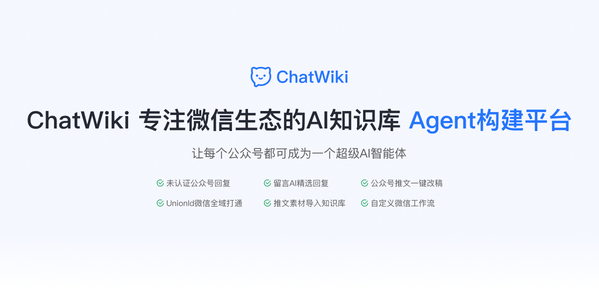
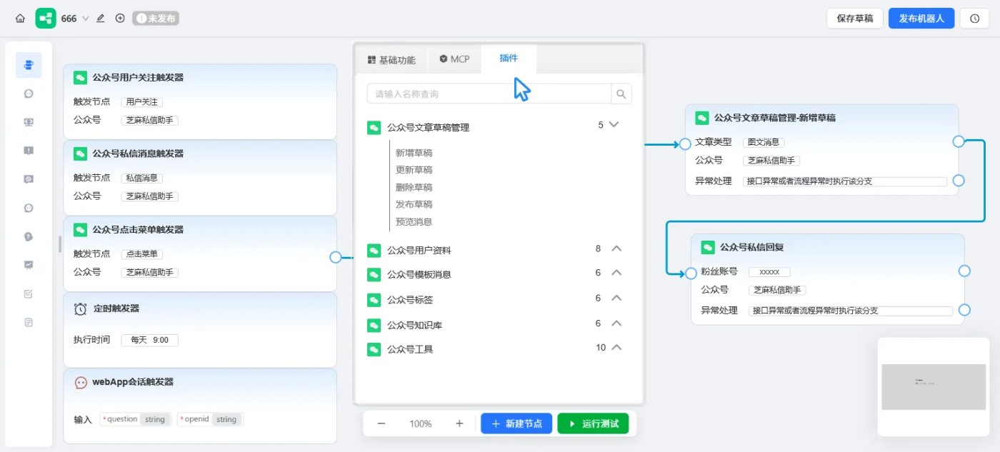
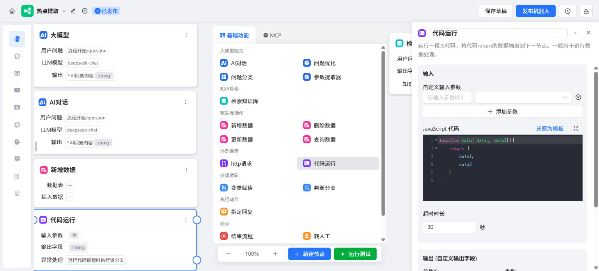
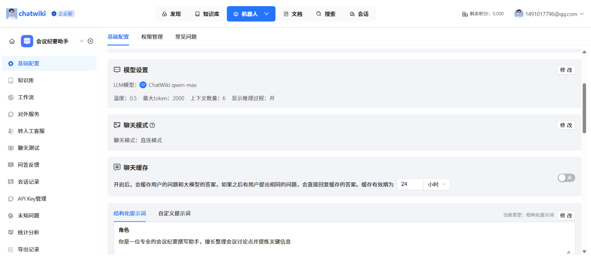
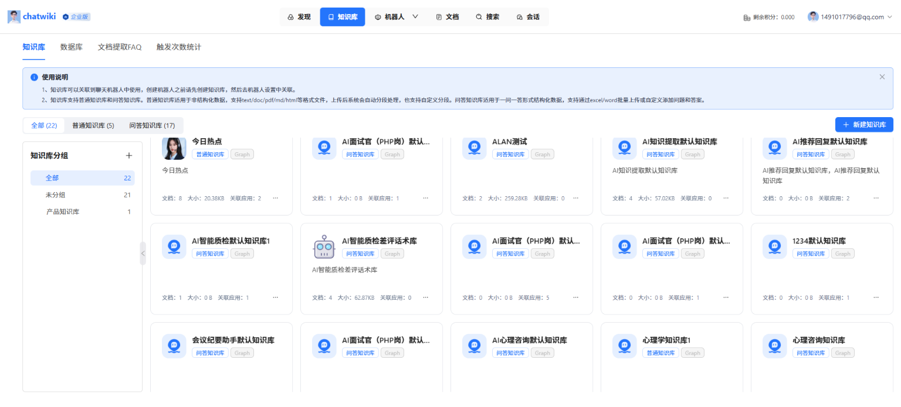
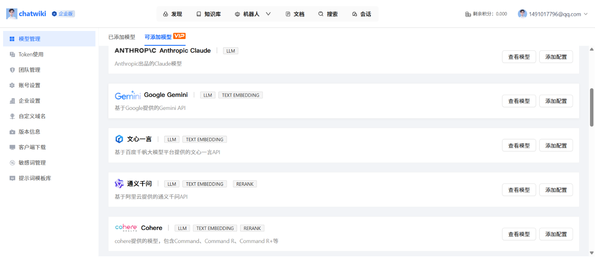
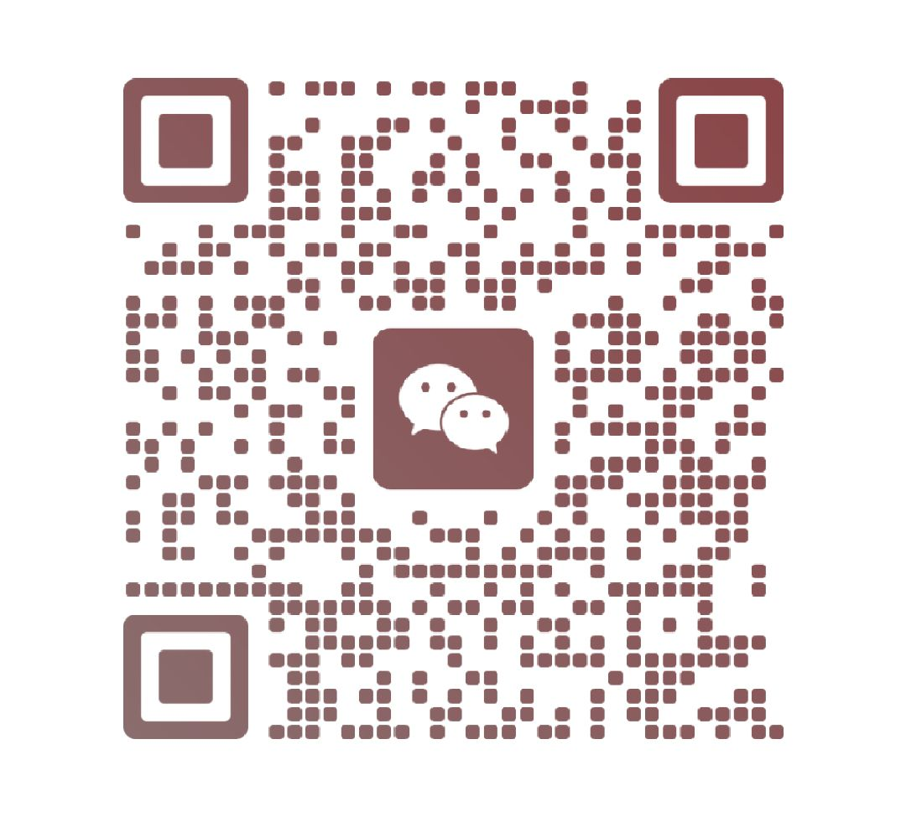

<p align="center"><a href="https://Chatwiki.com/"></a></p>

<p align="center">
  <a href="./README.md">English</a> |
  <a href="./README_zh.md">简体中文</a> |
  <a href="./UpdateLog.md">更新日志</a> |
  <a href="https://www.yuque.com/zhimaxiaoshiwangluo/pggco1/ykeoauc4g9k2dwv1">帮助文档</a>
</p>

## 🎯 产品定位

ChatWiki 是一个专注微信生态的工作流自动化平台，致力于让每个公众号都可成为一个超级AI智能体。全面集成公众号平台的开放能力，拖拽即可搭建微信生态应用，实现公众号推文一键改稿、留言AI精选回复等能力



## ✨ 核心特性

### 💬 微信生态深度集成

- **全行业首创**：未认证公众号私信自动回复，支持文本、语音、图片、小程序卡片、视频消息等。

- **微信工作流**：集成用户私信、留言、关注、取关、点击菜单等触发场景，支持回复私信，粉丝打标签，生成草稿文章、发布文章等多种处理流程

- **知识库同步**：支持抓取公众号文章素材，一键建立知识库。

### 🤖 基础能力

- **工作流编排：** 对话工作流、插件工作流，包含基础的工作流节点、双向 MCP、Agent 模式、用户交互。

- **文档知识库：** 支持 url 读取、文档批量导入、API 对接、支持AI分段、QA分段、父子分段。支持向量、全文和混合检索。

- **问答知识库：** 上传文档自动抽取问答知识，支持未知问题自动聚类，支持从人工对话中总结常用FAQ

- **转人工客服：** 通过机器人处理一般的用户咨询，同时支持人工客服接待。机器人处理不好的问题可以由人工客服介入处理，支持多客服协同分配。

- **模型支持：** 支持DeepSeek R1、doubao pro、qwen max、Openai、Claude 等全球20多种主流模型。

### 🌐 更多能力

- **多种部署方式**：提供桌面客户端、支持发布为WebApp，支持嵌入网站、公众号服务号、微信客服、微信小店客服等

- **MCP&API集成**：可引入外部MCP服务，或将工作流发布为MCP服务。完整的OpenAPI接口，轻松集成现有业务系统。

- **多账号权限管理**：管理、编辑、查看三级权限体系，实现数据权限隔离。IP白名单、登录日志永久留存。

## 🛸UI

- 🌍 **免费体验网址**： [chatwiki.com](https://chatwiki.com/)
- 🖼️ **系统截图**：

<p align="center">       </p> 
<p align="center">       </p> 

## 🚀 一键部署

ChatWiki 社区版基于 Docker 部署，只需简单几步即可完成安装：

```
# 安装 Docker
sudo curl -sSL https://get.docker.com/ | CHANNEL=stable sh
# 克隆项目
git clone https://github.com/zhimaAi/chatwiki.git
cd chatwiki/docker
# 启动服务
docker compose up -d
# 开始使用，通过IP+端口访问(需要开放指定的端口${CHAT_SERVICE_PORT},默认18080)
# 默认账号：admin
# 默认密码：chatwiki.com@123
```

在安装和部署中有任何问题或者建议，可以 [联系我们](https://github.com/zhimaAi/chatwiki?tab=readme-ov-file#contact-us)
或者查看 [帮助文档](https://www.yuque.com/zhimaxiaoshiwangluo/pggco1?source=aHR0cHM6Ly9jaGF0d2lraS5jb20v)
获取帮助，也可以参考下面的文档。

- [通过chatwiki安装助手安装](https://www.yuque.com/zhimaxiaoshiwangluo/pggco1/tvwn5npk63aqikq1)

- [一键部署ChatWiki社区版](https://www.yuque.com/zhimaxiaoshiwangluo/pggco1/wql8ekkylbwegbzo)

- [docker镜像站安装+离线安装](https://www.yuque.com/zhimaxiaoshiwangluo/pggco1/aa3htgexhdocyagr)

- [免Docker部署ChatWiki](https://www.yuque.com/zhimaxiaoshiwangluo/pggco1/klriercbhpy97o0g)

- [宝塔Linux面板部署ChatWiki社区版](https://www.yuque.com/zhimaxiaoshiwangluo/pggco1/gefgwdfnclua7d9y)

- [使用1Panel部署ChatWiki社区版](https://www.yuque.com/zhimaxiaoshiwangluo/pggco1/munvto5g1ctc1gcu)

- [如何配置模型供应商及支持的模型](https://www.yuque.com/zhimaxiaoshiwangluo/pggco1/pn79lkvl53bo0xxm)

- [本地模型部署](https://www.yuque.com/zhimaxiaoshiwangluo/pggco1/evmy0rr9gr2gp2i0)

- [如何配置对外服务和接收推送的域名](https://www.yuque.com/zhimaxiaoshiwangluo/pggco1/nfk4slc95s4i8u4v)

- [如何获取大模型ApiKey](https://www.yuque.com/zhimaxiaoshiwangluo/pggco1/lx3ho90skq95dpdq)

## 💻 技术栈

----

- 前端：vue.js

- 后端：golang +python

- 数据库：PostgreSQL16+pgvector+zhparser

<h2>🏡社区交流&联系我们 <a name="contact-us"></a></h2>

----
欢迎联系我们获取帮助，或者提供建议帮助我们改善ChatWiki。您可以通过以下方式联系我们：

- **帮助：** 查看 [帮助文档](https://www.yuque.com/zhimaxiaoshiwangluo/pggco1?source=aHR0cHM6Ly9jaGF0d2lraS5jb20v)
- **邮箱：** 您可以发送邮件到 [jarvis@2bai.com.cn](mailto:jarvis@2bai.com.cn)联系我们。
- **微信：** 使用微信扫码加入ChatWiki技术交流群，添加请备注“chatwiki”

<p align="left"></p>

## 📖 **更新日志**

---
查看完整更新日志请点击👉️👉️[UpdateLog.md](./UpdateLog.md)

**2026/11/13**

1.【STD】小红书系统内回复在会话记录内显示对应标识<br/>
2.新版交互下Agent对应的菜单交互修改<br/>
3.【STD】注册流程支持匹配设置默认跳过邀请码<br/>
4.增加AI辅助优化提示词工具<br/>
5.新版的知识库页面需要增加知识库设置<br/>
6.【STD】免费版:模型管理页面问题修复增加引导信息<br/>
7.修复开放接口获取机器人配置中的欢迎语未设置多语言时未兜底旧数据问题<br/>
8.移除neo4j及知识图谱检索相关逻辑<br/>
9.查看问答反馈的交互修改,支持查看对应聊天记录<br/>
10.新版交互-机器人名称改成13px最多两行<br/>
11.统计分析内:按日期筛选,支持放开到31天<br/>
12.【STD】AI推荐回复原文模式和传统模式逻辑调整<br/>
13.阿里百炼:使用思考开关替代`reasoning_effort=none`<br/>

**2026/11/06**

1.【STD】客服系统H5云客服:大模型机器人回复的内容增加点赞和点踩<br/>
2.【STD】模型选择器显示的ChatWiki自有模型积分价格问题修复<br/>
3.大模型开启深度思考时支持思考程度等级选择调节<br/>
4.Agent机器人支持独立设置每个Agent机器人的权限<br/>
5.【STD】修复多模态输入的重复问题转人工判断<br/>
6.修正多模态输入的纯文本提取场景<br/>
7.修正会话记录内,机器人回复的消息换行没有显示<br/>
8.全文检索改用pg-search 的BM25索引<br/>
9.开放接口:聊天API支持未知问题提示语回复智能菜单<br/>
10.【STD】云版Agent调用工作流针对转人工节点的问题优化<br/>
11.【STD】云版Agent机器人增加转人工客服内置工具<br/>
12.工作流结束节点指定回复多条消息时,以多条消息的形式回出来<br/>
13.机器人会话结束时间,支持自定义设置<br/>
14.工作流代码运行安全优化:python禁止子进程+最小只读挂载+禁止使用网络请求<br/>
15.新增系统模式配置:AI客服/Agent智能客服/AI知识库工作流<br/>
16.【STD】增加ChatWiki自有模型积分消耗流水记录查询<br/>
17.修复国际化中间件响应状态码透传问题<br/>
18.补齐用户管理接口数据修改越界的租户归属与权限校验问题<br/>
19.通过 CHATWIKI_GODEBUG 默认禁用容器内 Go 服务的 MPTCP<br/>
20.Agent机器人的人设页面支持左右调整宽度,支持滚动<br/>
21.知识库在线数据获取服务:升级Playwright至1.64.1并预装镜像驱动<br/>
22.【STD】设置页面菜单优化增加分组<br/>
23.召回设置/召回测试:选择检索方式是全文检索-分词检索时增加相似度阈值<br/>
24.【STD】修复权限校验逻辑,确保超级管理员对模型菜单的访问权限<br/>
25.系统安全优化:限制快捷指令管理的租户范围<br/>
26.系统安全优化:校验表单字段所属租户和表单<br/>
27.系统安全优化:为知识库PDF单页预览增加鉴权<br/>
28.新版交互:新增备用模型未设置时显示提示<br/>
29.新版交互下增加skill菜单<br/>

**2026/10/16**

1.支持在对话,会话记录和实时会话界面显示Agent的执行记录<br/>
2.工作流:代码运行和HTTP请求节点异常分支增加错误日志输出<br/>
3.Agent代码运行走e2b平台的,使用直接调用替换bash调用命令<br/>
4.工作流内调试支持进行多轮对话<br/>
5.聊天机器人的自定义提示词增加长度超过10000的校验<br/>
6.JWT硬编码的秘钥修改成首次启动时动态生成的方式<br/>

## 协议

---

本项目遵循[ChatWiki Open Source License](https://github.com/zhimaAi/chatwiki/blob/main/LICENSE)
开源协议。[ChatWiki Open Source License](https://github.com/zhimaAi/chatwiki/blob/main/LICENSE)基于Apache License
2.0协议，但是有一些额外的限制：

1. ChatWiki 对个人用户免费，包括个人从事的非商业或商业活动。
2. 任何公司、组织、机构或团队若将 ChatWiki 用于商业目的，均须联系我们获得商业授权。
3. 在使用 ChatWiki 的前端组件时，您不得移除或修改其中包含的“ChatWiki”标识、商标或版权声明。

**完整的许可证文本请查看：[LICENSE](./LICENSE) 文件，需要获取商业授权请[联系我们](#contact-us)**

